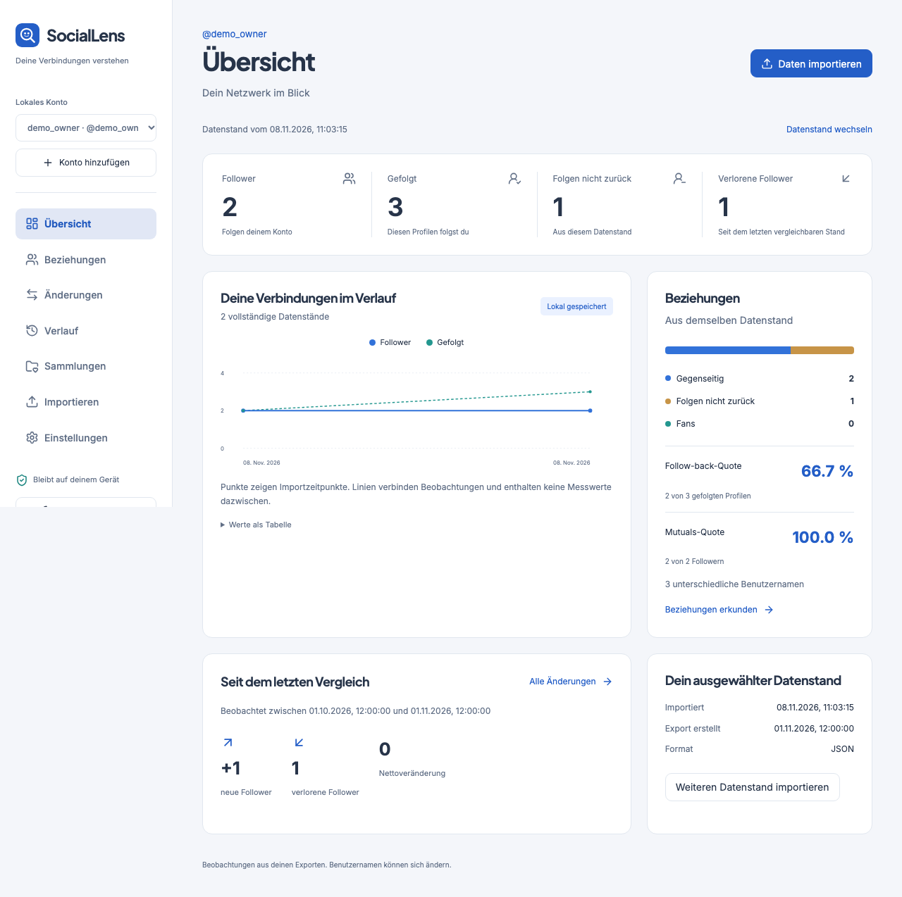

# SocialLens

Deine Instagram-Beziehungen lokal verstehen. SocialLens erweitert den MIT-lizenzierten [SafeUnfollow-Fork](https://github.com/ignromanov/safe-unfollow) um kontogetrennte Datenstände, Verlauf und persönliche Organisation.

## Starten

Node 24 LTS verwenden. Node 22 bleibt die Laufzeit der erhaltenen Upstream-CI. Keine `.env`, Serverdatenbank oder Instagram-Anmeldung erforderlich.

```sh
npm ci
npm run dev
```

Öffne die im Terminal angegebene lokale Adresse. Für einen Produktionsbuild mit installierbarer PWA, die nach vollständigem ersten Laden auch ohne Netzwerk verwendbar ist:

```sh
npm run build
npm run preview
```

Das veröffentlichbare Artefakt liegt ausschliesslich in `dist-sociallens/`. Nicht `dist/` veröffentlichen, denn dieses Verzeichnis enthält das separate ursprüngliche Upstream-Buildprofil. Die private Variante entfernt Dienstkonfiguration für Analytics, Werbung und Zahlungen selbst bei gesetzten `VITE_*`-Variablen. Ein HTTPS-Host muss SPA-Fallback und die Header aus `public-sociallens/_headers` übernehmen. Lokal ist `localhost` ein sicherer Browserkontext. Es wurde kein öffentlicher Hosting-Dienst eingerichtet.

## Nutzung

1. Ein lokales Konto anlegen. Es gibt keine Verbindung zum Instagram-Konto.
2. Einen offiziellen ZIP-Export öffnen, vorzugsweise JSON, Follower und Following, gesamter Zeitraum, ein Konto pro Archiv.
3. Vorschau, Kontozugehörigkeit und Vollständigkeit prüfen. Das Exportdatum nur angeben, wenn es verlässlich bekannt ist.
4. Weitere Datenstände importieren. Übersicht, Beziehungen, Änderungen, Verlauf und Sammlungen verwenden.
5. Regelmässig unter Einstellungen ein Backup speichern. Verschlüsselung mit eigener Passphrase ist optional.

Unterstützt werden JSON und HTML einschliesslich gesplitteter Follower-Dateien. Suche, Sortierung, virtuelle Listen, CSV, Favoriten, Whitelist, Notizen, Tags, eigene Listen, gespeicherte Filter und eine manuelle Prüfliste sind verfügbar. Monats-/Jahresrückblicke verwenden bekannte Exportdaten in UTC. Die Charts zeigen ausdrücklich Importzeitpunkte. Die Oberfläche ist deutsch, mobil nutzbar und bietet ein dunkles Design.

## Aussagekraft und Grenzen

- Ein Username ist keine garantierte Personenidentität. Umbenennungen können wie Zugang und Verlust aussehen.
- Gerichtete Veränderungen benötigen zwei vollständige Datenstände desselben Kontos und Formats mit bekannten, streng aufsteigenden Exportdaten. Importreihenfolge allein beweist keine zeitliche Reihenfolge.
- Änderungen liegen in einem Beobachtungsintervall. Exakte Entfolgezeiten und Vorgänge zwischen Exporten sind unbekannt. Fehlende Daten ergeben keine vermeintlichen Unfollower.
- Der Hash beruht auf normalisierten Listen. Identischer Inhalt wird pro Konto dedupliziert und erzeugt auch bei einem späteren unveränderten Export keinen weiteren Punkt. Ein bestätigter Reimport kann einen eingeschränkten Stand aufwerten.
- Kontozugehörigkeit und gesamter Exportzeitraum werden vom Nutzer bestätigt. Falsche Bestätigungen lassen sich aus den Listen allein nicht erkennen.
- Es gibt keine Ghost-Follower-Erkennung, Besucherlisten, Echtzeitüberwachung, automatische Entfolgeaktion oder Cloud-Synchronisation. Optionale professionelle Engagement-Schnittstellen benötigen eine gesonderte zulässige Datenquelle.
- ZIP-Limits sind 256 MiB Archiv, 32 MiB pro ausgewähltem Eintrag, 128 MiB ausgewählte Daten, 10.000 Einträge, 500 Beziehungsdateien und Kompressionsverhältnis 500. Unbekannte Exportlayouts werden abgewiesen oder eingeschränkt angezeigt.
- Browserdaten können verloren gehen. Browserprofil und Gerät schützen, Backups separat sichern. Die Passphrase kann nicht zurückgesetzt werden. Ein unverschlüsseltes Backup und CSV enthalten lesbare persönliche Daten.
- IndexedDB speichert die versionierte Arbeitsfläche transaktional. Sehr grosse Historien benötigen mehr Speicher und Zeit, da die Arbeitsfläche bei Änderungen validiert wird. Geprüfte Grössen sind im [Testprotokoll](docs/_sociallens/VERIFICATION.md) dokumentiert.

## Backup und alte Daten

Backups sind versionierte JSON-Archive mit SHA-256-Prüfsumme, optional AES-256-GCM und PBKDF2-SHA-256. Restore prüft das vollständige Schema, Kontoreferenzen und Snapshot-Hashes vor dem atomaren Austausch. Version 1 ist das erste SocialLens-Format. Neuere unbekannte Formate werden sicher abgewiesen, bis ein expliziter Migrationsadapter existiert.

Bestehende SafeUnfollow-Daten bleiben unverändert. In Einstellungen kann jede alte Analyse ausdrücklich einem lokalen Konto zugeordnet werden. Sie wird konservativ als eingeschränkter Legacy-Stand übernommen. Die bisherige Analyse samt zusätzlichen Datenkategorien bleibt unter `/legacy` erreichbar, das originale Entwicklungs-/Buildprofil über `npm run dev:upstream` und `npm run build:upstream`.

## Prüfung und Projektunterlagen

```sh
npm run format:check
npm run lint:strict
npm run type-check
npm run build:upstream
npm run test:coverage
npm run build
npx playwright install chromium firefox webkit
npm run test:e2e
```

[Architektur](docs/ARCHITECTURE.md) · [Ausgangsbasis](docs/BASELINE.md) · [Prüfergebnisse und Sicherheitsreview](docs/_sociallens/VERIFICATION.md) · [Änderungen](docs/_sociallens/CHANGELOG.md)



## Lizenz und Herkunft

SocialLens ist ein Fork von SafeUnfollow, MIT © Igor Romanov. [LICENSE](LICENSE), ursprüngliche Autorenhinweise und Quellcode bleiben erhalten. Der Build erzeugt `THIRD_PARTY_NOTICES.txt` aus den tatsächlich gebündelten Abhängigkeiten, einschliesslich Schriftlizenzen. Ergänzende Lizenztexte sind mit Herkunft unter [Lizenzen](docs/_sociallens/licenses/README.md) dokumentiert.

Die folgenden ursprünglichen Projektangaben beziehen sich auf SafeUnfollow. Dessen npm-Paket-/Zitationsmetadaten, Sprachumfang und Dienstangebote beschreiben das Upstream-Projekt. SocialLens hat die oben beschriebene deutsche private Oberfläche und ein eigenes Buildprofil.

<details>
<summary>Ursprüngliche SafeUnfollow-Dokumentation und Zitation</summary>

<div align="center">
  
  <h1>SafeUnfollow — Instagram Unfollow Tracker</h1>
</div>

<br>

[](https://doi.org/10.5281/zenodo.22663615)


<div align="left">
    <a href="https://www.producthunt.com/products/instagram-unfollow-tracker?embed=true&utm_source=badge-featured&utm_medium=badge&utm_source=badge-instagram&#0045;unfollow&#0045;tracker" target="_blank">
        
    </a>
</div>

<br>

**Find out who unfollowed you on Instagram** — analyze your Instagram Data Download ZIP locally to discover mutuals, non-mutuals, and connection patterns. No login, and the export never reaches a server: the ZIP is parsed in your browser.

## 🎯 What it does

Upload your Instagram data export and instantly see:

- **Who unfollowed you** — accounts that stopped following you
- **Who you follow but doesn't follow back** — one-way connections
- **Mutual followers** — accounts you both follow
- **Connection patterns** — understand your Instagram network

All processing happens **100% locally** in your browser: your Instagram export is parsed there and never uploaded.

## 📸 Screenshots

<div align="center">
  
  <p><em>Clean landing page with clear call-to-action</em></p>
</div>

<div align="center">
  
  <p><em>Drag and drop upload with pre-upload checklist</em></p>
</div>

<div align="center">
  
  <p><em>Analysis results with smart filters and account badges</em></p>
</div>

<details>
<summary>📱 <strong>View Mobile Screenshots</strong></summary>

<div align="center">
  
  <p><em>Mobile-optimized file upload</em></p>
</div>

<div align="center">
  
  <p><em>Filter by Close Friends and other badges on mobile</em></p>
</div>

</details>

## ✨ Key Features

- 🔍 **Find unfollowers** — see exactly who stopped following you
- 🔄 **Mutual analysis** — discover who follows you back vs. one-way connections
- 🏷️ **Smart badges** — Following, Followers, Mutuals, Not following back, Not followed back, Pending, Restricted, Close friends, Unfollowed, Dismissed
- 🔎 **Lightning-fast search** — trigram/prefix indexes for instant results (even with 1M+ accounts)
- ⚡ **Optimized for scale** — columnar storage and bitsets, built for millions of accounts
- 📱 **Responsive design** — works perfectly on desktop and mobile
- 🌙 **Dark mode** — comfortable viewing in any lighting
- 💾 **Smart caching** — instant reload with IndexedDB persistence
- 📊 **Sample data** — try it without uploading your own data
- 🌍 **10 languages** — English, Spanish, Russian, German, Portuguese, Turkish, French, Indonesian, Japanese, Arabic (RTL)
- 📲 **PWA support** — install as an app from the browser menu
- 🛡️ **Error recovery** — graceful error handling with recovery options

## 🌍 Multilingual Support

Available in **10 languages** with full RTL support:

| Language         | Code | RTL |
| ---------------- | ---- | --- |
| English          | en   | —   |
| Español          | es   | —   |
| Русский          | ru   | —   |
| Deutsch          | de   | —   |
| Português        | pt   | —   |
| Türkçe           | tr   | —   |
| Français         | fr   | —   |
| Bahasa Indonesia | id   | —   |
| 日本語           | ja   | —   |
| العربية          | ar   | ✅  |

- **73 pre-rendered pages** — SSG for instant load and SEO
- **Dynamic meta tags** — localized titles/descriptions per language
- **Browser language detection** — auto-redirects to preferred language

## 🚀 Why choose this over paid tools?

| Feature             | Instagram Unfollow Tracker                               | Paid Apps (Unfollowgram, etc.) |
| ------------------- | -------------------------------------------------------- | ------------------------------ |
| **Price**           | 💰 Free analysis · export paid once                      | 💸 $5-10/month                 |
| **Privacy**         | 🔒 Parsed in your browser                                | ⚠️ Sent to cloud servers       |
| **Instagram Login** | ✅ Not required                                          | ❌ Required (risky!)           |
| **Account Limit**   | ✅ 1M+ by design                                         | ⚠️ 10k-100k max                |
| **Data Processing** | ⚡ In your browser, no round-trip                        | 🐌 Cloud round-trip            |
| **Open Source**     | ✅ MIT license                                           | ❌ Closed source               |
| **Ads/Tracking**    | ⚠️ Ads + analytics — never usernames or your export file | ⚠️ Usually present             |
| **Platform**        | 🌐 Web (all devices)                                     | 📱 Mobile apps usually         |

### Why This Matters

- **🔒 100% Private** — all processing happens locally in your browser (IndexedDB)
- **💰 Free analysis** — no subscription, no account; the file export is a one-time purchase
- **🔓 Open Source** — transparent code you can audit and customize
- **⚡ Fast** — no network round-trip; filtering is local
- **🛡️ No Account Risk** — no Instagram login required, respects platform rules
- **🎯 Accurate Results** — clear mutual/non-mutual detection without gimmicks
- **📈 Scales to millions** — handles 1M+ accounts with ease (vs 100k limit in paid apps)

## 🚀 Quick Start

### Try it online

Visit the live demo: **[safeunfollow.app](https://safeunfollow.app)**

### Run locally

```bash
git clone https://github.com/ignromanov/safe-unfollow.git
cd safe-unfollow
npm install
npm run dev
```

Open the app and click **"Upload ZIP"** to load your Instagram Data Download, or **"Load sample"** to try the built-in demo data.

## 📥 How to get your Instagram data

### Quick Steps:

1. Go to [Meta Accounts Center](https://accountscenter.instagram.com/)
2. Navigate to **Your information and permissions** → **Download your information**
3. Select:
   - **Some of your information**
   - **Section**: Followers and Following
   - **Format**: JSON
   - **Date range**: All time
4. Download the ZIP file and upload it in the app

📖 **Detailed step-by-step guide**: Click the "❓ Help" button in the app for complete instructions with screenshots

## 🔒 Privacy & Security

- **100% Local Processing** — your Instagram export is parsed in your browser and never uploaded
- **Your export stays put** — the analytics we run never receive usernames or your export file
- **No Instagram Login** — works with your data export only
- **Open Source** — you can audit the code yourself

## ⚡ Performance

Built to handle massive datasets with cutting-edge optimization:

| Metric               | 10k accounts | 100k accounts | 1M accounts |
| -------------------- | ------------ | ------------- | ----------- |
| **Storage**          | ~100 KB      | ~1 MB         | ~5 MB       |
| **Filter Speed**     | <1ms         | ~2ms          | ~5ms        |
| **Search (indexed)** | <1ms         | <1ms          | ~1ms        |
| **Memory Usage**     | ~500 KB      | ~2 MB         | ~5 MB       |

⚠️ Filter speed and search speed are design targets, not measurements — no benchmark harness
exists in this repo, and the only 1M-scale test mocks IndexedDB entirely and asserts a 500ms
ceiling. The storage and memory columns are targets on the same footing.

**Technology Stack:**

- **IndexedDB v2** — columnar storage: usernames packed into typed arrays, not objects
- **FastBitSet.js** — one bit per account per badge, filtered with bitwise operations
- **TanStack Virtual** — renders only visible items (60 FPS scrolling)
- **Web Workers + Comlink** — type-safe off-thread filtering
- **Trigram/Prefix Indexes** — O(1) search instead of O(n) linear scan
- **vite-react-ssg** — 73 pre-rendered pages for SEO and instant loads
- **PWA (Workbox)** — runtime caching; only icons and the manifest are precached (`vite/pwa-config.ts`)

📖 **Deep dive:** [IndexedDB Architecture](INDEXEDDB_ARCHITECTURE.md)

## 🧪 Quality & Reliability

- **Tested** — the full suite runs in CI on every push
- **TypeScript Strict Mode** — type-safe development with full type checking
- **Modern Stack** — React 18, Vite, shadcn/ui, Tailwind CSS
- **Code Quality** — ESLint, Husky git hooks, automated quality checks
- **Error Boundaries** — graceful error handling with recovery UI
- **PWA** — installable; pages you have already opened keep working with the network off

## ❓ FAQ

**Q: Is it safe to use?**  
A: Yes! All processing happens locally in your browser. Your export is never uploaded to any server.

**Q: Do I need my Instagram password?**  
A: No. You only need the ZIP file from Instagram Data Download.

**Q: What does "Not following back" mean?**  
A: Accounts you follow who don't follow you back (excluding pending/restricted accounts).

**Q: Can I use it offline?**  
A: Partly. Pages and analyses you have already run keep working with the network off; a first visit and the first upload need a connection.

**Q: Does it work on mobile?**
A: Yes, the interface is fully responsive and works on all devices.

**Q: What languages are supported?**
A: 10 languages including Arabic with RTL support. The app auto-detects your browser language.

📖 **More questions?** See [FAQ](docs/faq.md) or [Troubleshooting Guide](docs/troubleshooting.md)

## 📄 Citing SafeUnfollow

Use the **Cite this repository** button above, or [`CITATION.cff`](CITATION.cff) directly.
The DOI below is the concept DOI and always resolves to the newest archived version:

> Romanov, I. _SafeUnfollow_. https://doi.org/10.5281/zenodo.22663615

The version, repository, site and licence in `CITATION.cff` are checked against
`package.json` on every CI run, so a citation cannot disagree with the code it points at.
The source tree is also archived by [Software Heritage](https://archive.softwareheritage.org/browse/origin/directory/?origin_url=https://github.com/ignromanov/safe-unfollow).

## 🤝 Contributing

Contributions are welcome! Whether it's:

- 🐛 Bug reports
- 💡 Feature requests
- 🔧 Code improvements
- 📖 Documentation updates

See [CONTRIBUTING.md](CONTRIBUTING.md) and [CODE_OF_CONDUCT.md](CODE_OF_CONDUCT.md) for guidelines.

## 📚 Documentation

- **[User Guide](docs/user-guide.md)** - Complete step-by-step tutorial
- **[FAQ](docs/faq.md)** - Common questions and answers
- **[Troubleshooting](docs/troubleshooting.md)** - Problem-solving guide
- **[Data Download Guide](docs/instagram-export.md)** - How to get your Instagram data
- **[Accessibility](docs/accessibility.md)** - Accessibility features and support
- **[Privacy Policy](docs/privacy.md)** - Data handling principles
- **[Roadmap](docs/roadmap.md)** - Future features
- **[Technical Specs](docs/tech-spec.md)** - Technical details

## 📄 License

MIT License — see [LICENSE](LICENSE) for details.

**Disclaimer**: This project is not affiliated with Instagram/Meta. Use your data export in accordance with platform rules.

---

## 💖 Support Me

⭐ **Found this useful?** Star the repo and share it with others looking for a free Instagram unfollow tracker!

<p align="left">
  <a href="https://www.buymeacoffee.com/ignromanov" target="_blank">
    
  </a>
</p>

</details>
